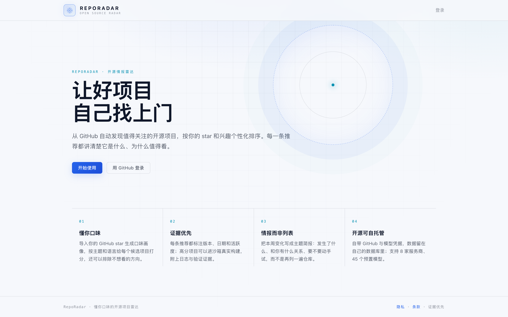
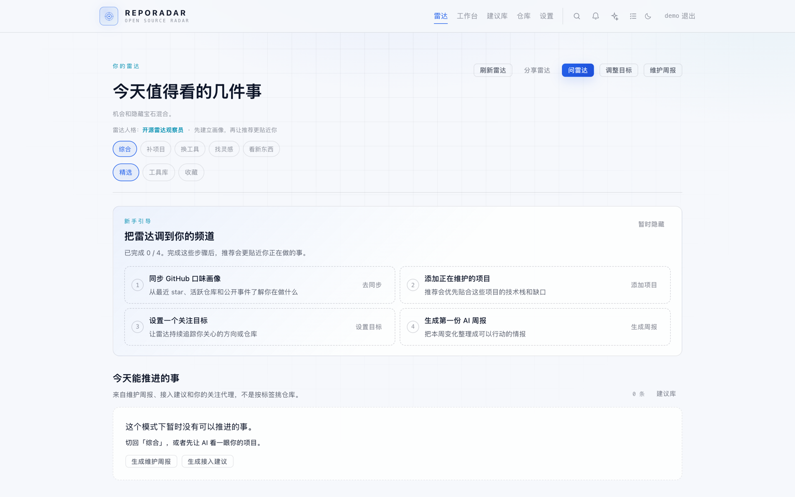
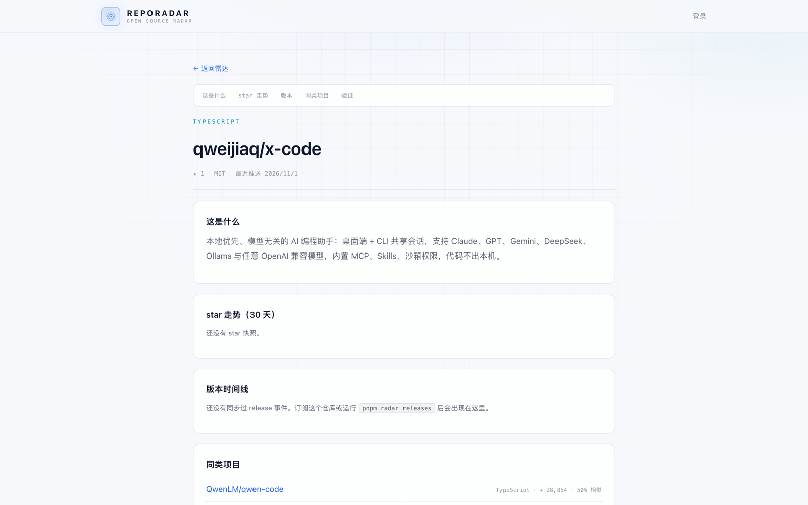

# RepoRadar

> A personalized radar for open-source projects: discover what is worth using, understand why it fits, and see what to do next.

[](https://github.com/qweijiaq/RepoRadar/actions/workflows/ci.yml)
[](LICENSE)
[](package.json)
[](package.json)

[中文说明](README.md)



- **Who it is for**: developers who browse GitHub regularly and maintain one or two projects of their own.
- **What it solves**: it replaces star-ranked lists with decisions — what a project is, why it matters to you now, and whether it is worth integrating.
- **How it is different**: it reads your star profile and maintained projects, and can clone / install / build candidates in a Docker sandbox with logs kept as evidence.
- **How to run it**: Docker Compose self-hosting; repository data, GitHub tokens and model keys stay in your own database.

## At a glance

- **Daily radar**: opportunity cards, hidden gems and a tool library ranked by your taste, with a reason for every recommendation.
- **Integration suggestions**: pick a project you maintain; the AI finds libraries that fill real gaps and produces an implementation brief for Claude Code or Cursor.
- **Similar-project comparison**: compare direct competitors, target advantages, borrowable ideas and copy-paste risks.
- **Maintainer weekly**: health, dependency upgrades and issue/PR triage in one report, backed by real lockfiles, npm/PyPI/Go/crates.io and OSV.
- **Recommendation library**: every historical suggestion is grouped by repository with adopted, rejected and pending states.

## How it compares

| | Ranking signal | Can verify builds | Self-hosted |
| --- | --- | --- | --- |
| **RepoRadar** | Your stars, subscriptions, maintained projects and feedback | Clone / install / build in a Docker sandbox; patch and dependency-upgrade checks | Yes |
| GitHub Explore / Trending | Global popularity and editorial picks | No | No |
| Trendshift | Star velocity and trends | No | No |
| daily.dev | Community posts and tags | No | No |

## Screenshots

| First run on `/feed` | Project intelligence page |
| --- | --- |
|  |  |

## Quick start

### Docker

```bash
cp .env.example .env
# set AUTH_SECRET, ADMIN_LOGINS and SETUP_TOKEN
docker compose up -d --build
curl -fsS http://localhost:3000/api/health
```

Open `http://localhost:3000/setup` to configure GitHub OAuth, then add a model API key in Settings. The radar works without a model key, but report generation does not.

### Local development

```bash
docker compose up -d postgres
pnpm install
cp .env.example .env
cp apps/web/.env.local.example apps/web/.env.local
# set AUTH_SECRET; set AUTH_DEV_MODE=1 to skip GitHub OAuth locally
pnpm db:migrate
pnpm dev:web        # http://localhost:3000
```

Detailed setup, commands and environment variables are in [docs/DEVELOPMENT.md](docs/DEVELOPMENT.md). The detailed docs are currently in Chinese.

## Documentation

| Document | Contents |
| --- | --- |
| [Features](docs/FEATURES.md) | Radar, integrations, comparisons, maintainer reports, library, MCP |
| [Deployment](docs/DEPLOYMENT.md) | Docker Compose, Caddy/Nginx, TLS, backups |
| [Operations](docs/OPERATIONS.md) | Observability, GitHub scopes, notifications, quotas |
| [Development](docs/DEVELOPMENT.md) | CLI, environment variables, structure, tests, sandbox |
| [Roadmap](docs/ROADMAP.md) | Next-stage validation and product direction |

## Known limitations

- Early-stage project: interfaces and report formats will change.
- No hosted demo yet; use the screenshots above or run Docker locally.
- AI features need your own model key and consume tokens.
- Sandbox verification executes untrusted build scripts; isolate the worker in production.
- Deleting repositories requires the separate `delete_repo` scope; RepoRadar never deletes anything automatically.
- GitHub Search API rate limits mean trend signals need a few days of collection.
- It does not auto-commit, push or open pull requests; patches and integration briefs need human review.

## Roadmap

Next up: a hosted demo, more signal sources (HN / Reddit / steadier GitHub trends), and a team radar. See [docs/ROADMAP.md](docs/ROADMAP.md).

## License

Apache-2.0. See [LICENSE](LICENSE).
