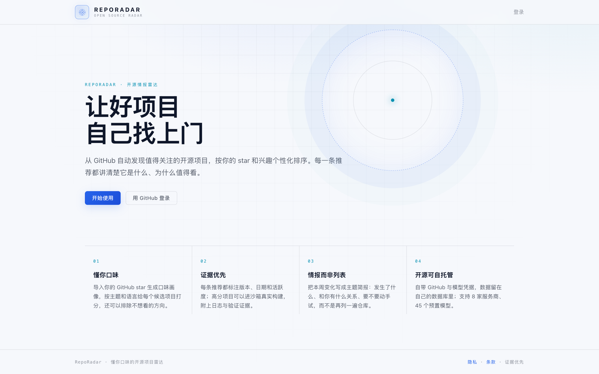
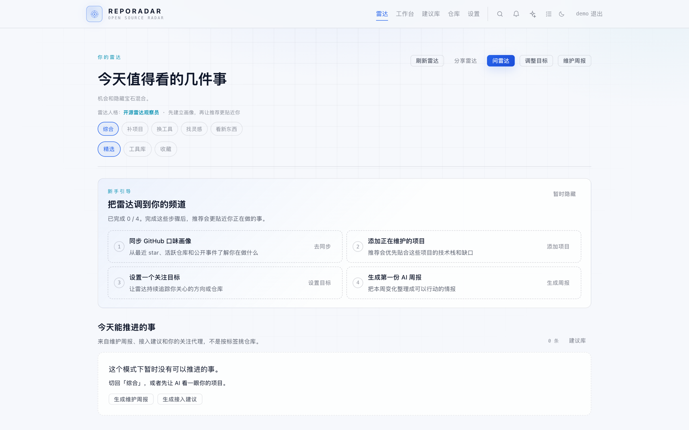
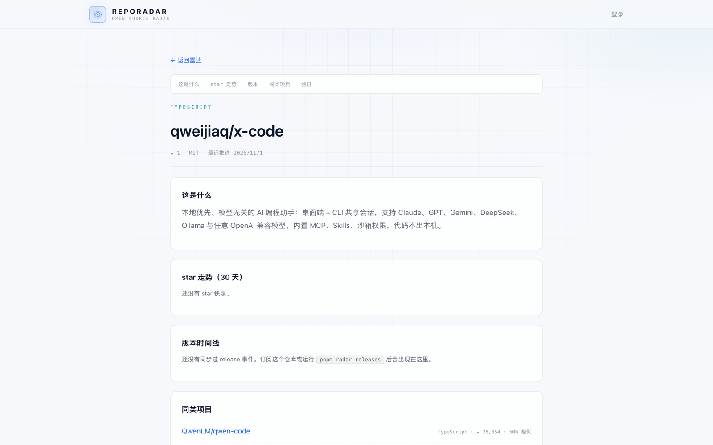

# RepoRadar

> 一个懂你口味的开源项目雷达：按你的技术栈、star 画像和正在维护的项目，发现值得用的新项目，并告诉你下一步能做什么。
>
> [English](README.en.md) · 中文

[](https://github.com/qweijiaq/RepoRadar/actions/workflows/ci.yml)
[](LICENSE)
[](package.json)
[](package.json)



- **为谁做**：每天刷 GitHub、手里又维护着 1–2 个项目，想把「发现项目」变成稳定工作流的开发者。
- **解决什么**：不再只看 star 榜单，而是知道一个项目和你现在做的事有什么关系、值不值得接入、下一步该做什么。
- **和推荐器的区别**：它会读你的 star 画像和维护项目，也能在 Docker 沙箱里真实 clone / install / build，给出带日志的验证结果。
- **怎么用**：支持 Docker Compose 自托管，数据、GitHub token 和模型 Key 都留在自己的数据库里。

## 30 秒了解

- **每日雷达**：机会卡 + 隐藏宝石 + 工具库，按你的口味排序；工具库卡片可以展开看分数由哪些维度组成。
- **接入建议**：选中正在维护的项目，AI 找可以补位的开源库，给出理由、步骤和风险，生成能直接交给 Claude Code / Cursor 的接入工作流。
- **相似项目对比**：找同赛道项目，对比双方强弱、可以借鉴的设计和直接照搬的风险。
- **维护周报**：健康度、依赖升级、Issue/PR 待办合成一张周报，依赖升级会查真实 lockfile、npm/PyPI/Go/crates.io 和 OSV。
- **建议库**：历史接入、关注、维护、对比和曝光建议按库归档，显示出现次数、已接入、不感兴趣和待处理状态。

## 和同类工具的区别

| | 推荐依据 | 能否验证可构建 | 自托管 |
| --- | --- | --- | --- |
| **RepoRadar** | 你的 star、订阅、维护项目和反馈 | 可以在 Docker 沙箱里 clone / install / build，也支持补丁和依赖升级验证 | 支持 |
| GitHub Explore / Trending | 全站热度、编辑推荐 | 否 | 否 |
| Trendshift | star 增速与趋势 | 否 | 否 |
| daily.dev | 社区内容与标签 | 否 | 否 |

## 界面预览

| 首次打开 `/feed` | 项目情报页 |
| --- | --- |
|  |  |

## 快速开始

### 只想先跑起来（Docker）

```bash
cp .env.example .env
# 至少设置 AUTH_SECRET、ADMIN_LOGINS、SETUP_TOKEN
docker compose up -d --build
curl -fsS http://localhost:3000/api/health
```

打开 `http://localhost:3000/setup` 配置 GitHub OAuth，然后登录、在设置页填入模型 API Key。没有模型 Key 也能使用采集、列表和基础雷达。

完整部署、TLS、备份与安全边界见 [docs/DEPLOYMENT.md](docs/DEPLOYMENT.md)。

### 本地开发

```bash
docker compose up -d postgres
pnpm install
cp .env.example .env
cp apps/web/.env.local.example apps/web/.env.local
# 至少设置 AUTH_SECRET；本地想跳过 GitHub OAuth 可把 AUTH_DEV_MODE 改为 1
pnpm db:migrate
pnpm dev:web        # http://localhost:3000
```

命令、环境变量、模型配置和测试方式见 [docs/DEVELOPMENT.md](docs/DEVELOPMENT.md)。

## 文档

| 文档 | 内容 |
| --- | --- |
| [功能与页面](docs/FEATURES.md) | 雷达、接入、相似对比、维护周报、建议库、MCP 和各个页面 |
| [评分与可解释性](docs/SCORING.md) | 推荐分数的组成、默认权重、版本和评测 |
| [部署](docs/DEPLOYMENT.md) | Docker Compose、Caddy/Nginx、TLS、备份恢复 |
| [运维与安全](docs/OPERATIONS.md) | 可观测性、GitHub 权限、通知、保留策略、限流配额 |
| [开发与命令](docs/DEVELOPMENT.md) | CLI 命令、环境变量、项目结构、测试和沙箱验证 |
| [路线图](docs/ROADMAP.md) | 下一阶段的验证和产品方向 |
| [产品设计](docs/PRD.md) | 产品假设、数据模型和架构设计 |

## 已知限制

- 项目仍在早期，接口、报告格式和页面会继续调整；欢迎提 Issue，但不建议直接用于关键生产流程。
- 暂时没有托管在线 demo；可以先看上面的截图，或用 Docker 在本机启动。只读分享快照 `/radar/[token]` 已可用。
- AI 功能需要自己配置模型 Key，会消耗 token；不配模型时只能使用采集、列表和基础雷达。
- 沙箱验证会执行仓库里的构建脚本，属于不可信代码；生产环境请把 worker 隔离部署，不要和数据库共用主机。
- 删除仓库需要单独授权 `delete_repo`；RepoRadar 不会自动删除任何仓库。
- GitHub Search API 有速率限制，候选池需要几天积累才能形成稳定的趋势信号。
- 它不会自动提交、推送或创建 PR；补丁和接入方案都需要人工审阅。

## Roadmap

下一阶段聚焦三件事：托管 demo、更多信号源（HN / Reddit / 更稳定的 GitHub 趋势）、团队技术雷达。详见 [docs/ROADMAP.md](docs/ROADMAP.md)。

## 许可证

Apache-2.0，见 [LICENSE](LICENSE)。
