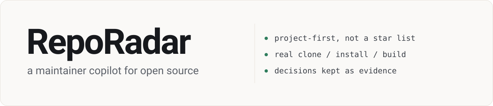
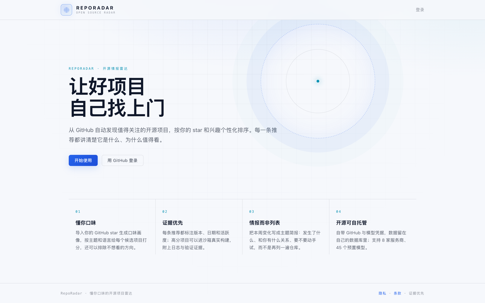
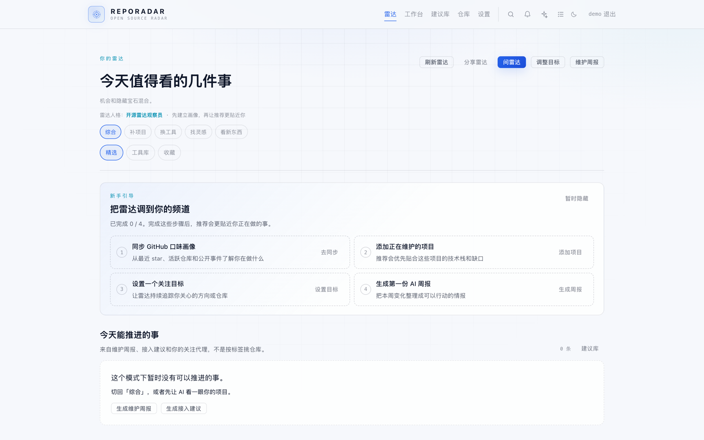
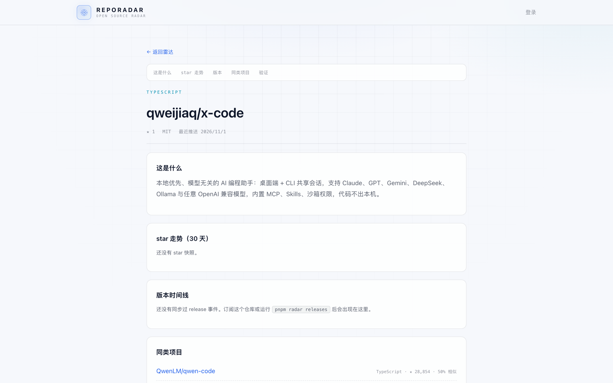

<p align="center">
  
</p>

<h1 align="center">RepoRadar</h1>

<p align="center">
  <a href="https://github.com/qweijiaq/RepoRadar/actions/workflows/ci.yml"></a>
  <a href="LICENSE"></a>
  <a href="package.json"></a>
  <a href="package.json"></a>
</p>

<p align="center">
  <a href="README.md">English</a> · <strong>简体中文</strong>
</p>

> 一个项目维护副驾：从你正在维护的项目出发，找值得接入的开源库，用证据和 Docker 沙箱验证，再把「接入 / 放弃 / 稍后」的决策记录下来。

> **自托管开源项目**：RepoRadar 不提供官方在线服务，也不托管用户数据。GitHub OAuth、Postgres、模型 Key 和备份都由部署者自己管理。



- **为谁做**：手里维护着 1–2 个项目，需要判断「下一个库该不该接入、怎么接、风险在哪」的开发者。
- **解决什么**：不是再给一个 star 榜单，而是给正在维护的项目找到下一块拼图，并留下可回看的验证和决策。
- **和推荐器的区别**：它读你的项目上下文和真实依赖，也能在 Docker 沙箱里真实 clone / install / build，给出带日志的验证结果。
- **怎么用**：支持 Docker Compose 自托管，数据、GitHub token 和模型 Key 都留在自己的数据库里。

## 30 秒了解

- **接入建议**：选中正在维护的项目，AI 找可以补位的开源库，给出理由、步骤和风险，生成能直接交给 Claude Code / Cursor 的接入工作流。
- **沙箱验证**：在 Docker 里真实 clone / install / build，留下 diff、命令、耗时和失败原因，不碰远端仓库。
- **相似项目对比**：找同赛道项目，对比双方强弱、可以借鉴的设计和直接照搬的风险。
- **维护周报**：健康度、依赖升级、Issue/PR 待办合成一张周报，依赖升级会查真实 lockfile、npm/PyPI/Go/crates.io 和 OSV。
- **建议库**：历史接入、关注、维护、对比和曝光建议按库归档，显示出现次数、已接入、不感兴趣和待处理状态。
- **每日雷达**：机会卡 + 隐藏宝石 + 工具库，作为第二入口；不想刷的时候，就只处理项目里的下一件事。

## 和同类工具的区别

| | 推荐依据 | 能否验证可构建 | 自托管 |
| --- | --- | --- | --- |
| **RepoRadar** | 你的 star、订阅、维护项目和反馈 | 可以在 Docker 沙箱里 clone / install / build，也支持补丁和依赖升级验证 | 支持 |
| GitHub Explore / Trending | 全站热度、编辑推荐 | 否 | 否 |
| Trendshift | star 增速与趋势 | 否 | 否 |
| daily.dev | 社区内容与标签 | 否 | 否 |

## 界面预览

| 首次打开 `/feed` | 项目情报页 |
| --- | --- |
|  |  |

## 快速开始

### 前置条件

- Docker + Docker Compose
- 一个 GitHub OAuth App（用于登录）
- 推荐：`GITHUB_TOKEN`，避免 GitHub Search 限流和采集超时
- 可选：任意 OpenAI 兼容模型 Key（不配置时只能使用采集、列表和基础雷达）
- 本地开发还需要 Node.js 22+、pnpm 11.9+

### 只想先跑起来（Docker）

```bash
cp .env.example .env
# 至少设置 AUTH_SECRET、ADMIN_LOGINS、SETUP_TOKEN
# 强烈建议同时设置 GITHUB_TOKEN，避免 GitHub Search 限流和采集超时
docker compose up -d --build
curl -fsS http://localhost:3000/api/health
```

打开 `http://localhost:3000/setup` 配置 GitHub OAuth，然后登录、在设置页填入模型 API Key。没有模型 Key 也能使用采集、列表和基础雷达。

可选：先写入一份演示数据，未采集前也能看到完整界面：

```bash
docker compose --profile demo run --rm demo-seed
```

检查后台 worker：

```bash
docker compose logs -f worker
```

### 只想公开一个推广/演示站

如果你只想把首页作为项目官网和只读演示，不希望访客在你的实例里创建账号：

```bash
RADAR_PROMO_MODE=1 RADAR_DEMO_MODE=1 docker compose --profile demo up -d --build
```

这个模式会：

- 在官网顶部显示「推广站 · 只读演示」
- 关闭普通访客的 GitHub 登录，只保留 `demo-radar` 只读演示账号
- 不创建访客账号，不保存访客的 GitHub Token 或个人配置
- 建议、同感和公开排期交给独立的 Feedback Desk 服务，不写入 RepoRadar 主库
- 首页的「自托管」入口引导用户 clone 后部署完整实例

### 官网建议与公开排期

官网的「建议与公开排期」不再由 RepoRadar 自己存储，而是读取桌面的 Feedback Desk 服务，并用官网自己的 UI 渲染：

```bash
cd ~/Desktop/feedback-desk
npm start
```

后台默认在 `http://127.0.0.1:8787/admin`，管理员令牌在 `data/admin-token.txt`。

在 RepoRadar 的 `.env` 中配置：

```env
FEEDBACK_DESK_URL=http://127.0.0.1:8787
FEEDBACK_DESK_PROJECT=repo-radar
```

官网通过浏览器请求 Feedback Desk 的公开 API，所以 `FEEDBACK_DESK_URL` 必须是访客浏览器能访问到的地址（例如反向代理或内网穿透后的 HTTPS 地址），不能只写服务器本机的 `127.0.0.1`。CSP 的 `connect-src` 会自动允许这个地址。

Feedback Desk 里创建 `repo-radar` 项目后，用户在官网提交的建议、维护者的状态、拒绝原因、公开回复和同感都会保存在留言台的 SQLite 数据库里，RepoRadar 主库不会新增留言表。

真正给用户使用的实例请设置 `RADAR_PROMO_MODE=0`，并配置自己的 GitHub OAuth。

完整部署、TLS、备份与安全边界见 [docs/DEPLOYMENT.md](docs/DEPLOYMENT.md)。

### 本地开发

```bash
docker compose up -d postgres
pnpm install
cp .env.example .env
cp apps/web/.env.local.example apps/web/.env.local
# 至少设置 AUTH_SECRET；本地想跳过 GitHub OAuth 可把 AUTH_DEV_MODE 改为 1
pnpm db:migrate
pnpm dev:web        # http://localhost:3000
```

命令、环境变量、模型配置和测试方式见 [docs/DEVELOPMENT.md](docs/DEVELOPMENT.md)。

### 备份与升级

```bash
bash scripts/db-backup.sh
# 升级代码后重新构建并应用迁移
docker compose up -d --build
```

恢复会覆盖当前数据库，必须显式确认：

```bash
CONFIRM=YES bash scripts/db-restore.sh backups/xxx.dump
```

## 文档

| 文档 | 内容 |
| --- | --- |
| [功能与页面](docs/FEATURES.md) | 雷达、接入、相似对比、维护周报、建议库、MCP 和各个页面 |
| [评分与可解释性](docs/SCORING.md) | 推荐分数的组成、默认权重、版本和评测 |
| [部署](docs/DEPLOYMENT.md) | Docker Compose、Caddy/Nginx、TLS、备份恢复 |
| [运维与安全](docs/OPERATIONS.md) | 可观测性、GitHub 权限、通知、保留策略、限流配额 |
| [开发与命令](docs/DEVELOPMENT.md) | CLI 命令、环境变量、项目结构、测试和沙箱验证 |
| [路线图](docs/ROADMAP.md) | 下一阶段的验证和产品方向 |
| [产品设计](docs/PRD.md) | 产品假设、数据模型和架构设计 |

## 已知限制

- 项目仍在早期，接口、报告格式和页面会继续调整；欢迎提 Issue，但不建议直接用于关键生产流程。
- 仅支持自托管，不提供官方在线账号服务；可以另开一个 `RADAR_PROMO_MODE=1` 的只读演示站做推广。完整使用请自己部署，或先看上面的截图。只读分享快照 `/radar/[token]` 已可用。
- AI 功能需要自己配置模型 Key，会消耗 token；不配模型时只能使用采集、列表和基础雷达。
- 沙箱验证会执行仓库里的构建脚本，属于不可信代码；生产环境请把 worker 隔离部署，不要和数据库共用主机。
- 删除仓库需要单独授权 `delete_repo`；RepoRadar 不会自动删除任何仓库。
- GitHub Search API 有速率限制，候选池需要几天积累才能形成稳定的趋势信号。
- 它不会自动提交、推送或创建 PR；补丁和接入方案都需要人工审阅。

## Roadmap

下一阶段聚焦自托管可靠性：v0.1 发布与文档完善、worker 与备份/升级路径、更多信号源（HN / Reddit / 更稳定的 GitHub 趋势）、团队技术雷达。RepoRadar 不计划提供官方托管服务。详见 [docs/ROADMAP.md](docs/ROADMAP.md)。

## 许可证

Apache-2.0，见 [LICENSE](LICENSE)。
