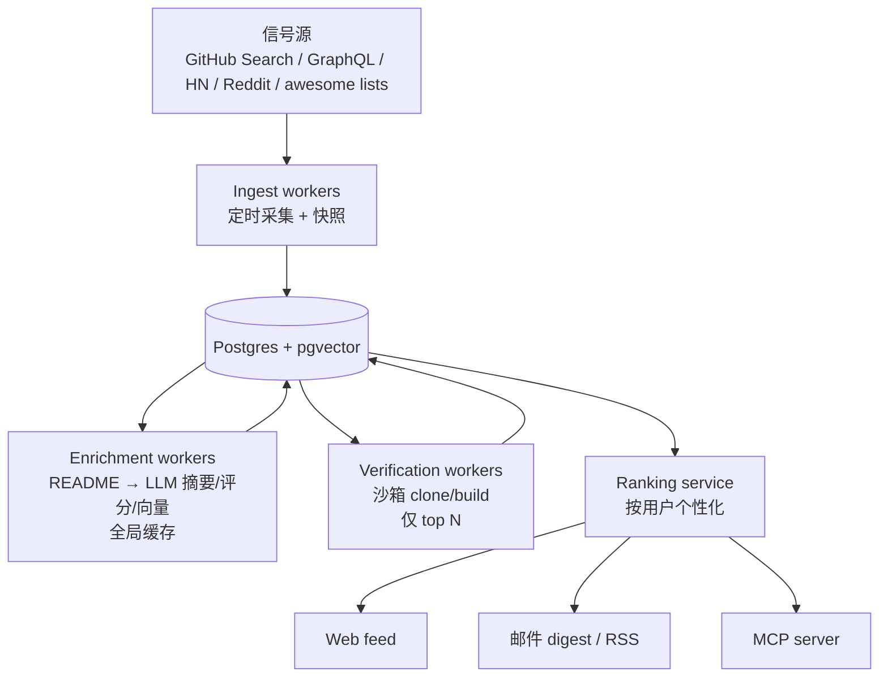

# RepoRadar 立项文档（PRD v0.1）

> 一句话：**一个懂你口味的开源项目雷达**——从 GitHub 及社区信号中自动发现值得关注的开源项目，按你的技术栈和兴趣个性化排序，给你「已验证、讲得清、可行动」的精选。

- 英文 tagline：*A personalized radar for open-source projects — verified, explained, and relevant to you.*
- 状态：立项 / 设计阶段（2026-10-30）
- 形态：开源项目（计划 Apache-2.0），自托管优先，官方托管 demo 作为补充
- 代号：RepoRadar（暂定；备选 Stargaze / Prospector / Signal）

---

## 1. 问题

开发者面对 GitHub 有三个未被满足的需求：

1. **发现**：我关注的领域里出现了什么新东西？
2. **判断**：哪一个值得我花时间？质量如何？解决什么问题？
3. **追踪**：我 star 过、依赖着的项目发生了什么变化？

现状的问题：

- GitHub Trending 对所有人一样，按绝对星数排序，被模板、SEO、玩具项目稀释，且没有历史数据（看不到增速）。
- 信息不缺，缺的是**筛选与信任**。大量 AI 日报产品只读 README 生成一段空洞介绍，推荐理由经不起追问，用户看两周就流失。GitPulse Weekly 的复盘（97 天、72 订阅、零收入停更）明确指出：这类产品要跨越「信任墙」，用户需要证据。
- 现有产品要么大众化（Trending 搬运），要么面向个人自用（GitHub 盲盒、OSS-Scout），没有一个把「个性化 + 验证 + 订阅变化」做成完整产品。

## 2. 目标用户

| 画像 | 描述 | 核心诉求 |
| --- | --- | --- |
| P1 独立开发者 / 小团队工程师 | 想持续跟进行业，但没时间刷 Trending | 每周 10 条真正相关的项目，附中文摘要和推荐理由 |
| P2 技术选型者 | 为项目或公司评估框架、库 | 质量证据、维护状况、替代品对比 |
| P3 技术内容创作者 | 需要选题和素材 | 有洞察的、可以二次创作的项目线索 |

非目标：招聘/求职流量、互刷 star、纯营销号内容。

## 3. 竞品与差异化

| 产品 | 做法 | 缺口 |
| --- | --- | --- |
| GitHub Trending / 搬运号 | 按星数/编辑精选 | 大众化、无个性化、无验证、无历史 |
| GitHub 盲盒 | fork 即跑，五语言维度抓 Trending，AI 按人设过滤 | 面向个人自用的脚本，无质量评审与产品形态 |
| OSS-Scout | MCP server + 口味画像，本地 SQLite | 工具调用形态，无内容产品与订阅闭环 |
| RepoMuse | agent 按计划探索并为每个仓库构建 demo | 最接近方向，但未做个性化订阅与雷达 |
| BAAM / GitPulse 等 agentic newsletter | 多信源（HN/GitHub/Reddit/arXiv）+ 编辑 agent | 编辑视角，非个性化；商业化已证伪 |
| ThoughtWorks Technology Radar | 人工季度技术雷达 | 权威但慢、贵、非个性化 |

**RepoRadar 的差异**：

1. **验证过的推荐**：高分候选在沙箱中真实 clone、构建/测试，附运行证据（日志、截图、耗时）。这是跨过「信任墙」的核心。
2. **个性化**：GitHub star 导入 + 显式画像 + 反馈闭环，而不是编辑口味。
3. **追踪变化**：订阅 release、breaking change、维护状态，而不只是推新项目。
4. **开源、可自托管、自带模型**：BYO LLM key，无厂商锁定，数据留在本地。
5. **多渠道分发**：Web / 邮件 / RSS / MCP（可在 Claude Code、Cursor、X-Code 中使用）。

## 4. 核心概念

- **Repo（候选项目）**：从信号源采集、富化、打分的开源仓库。
- **Taste Profile（口味画像）**：用户兴趣向量 + 显式规则（语言、域、排除项）。
- **Radar（雷达）**：为用户生成的项目流与摘要。
- **Subscription（订阅）**：topic / 语言 / 作者 / release / 关键词。
- **Verification（验证）**：沙箱 clone → build/test → 证据链。

## 5. MVP 范围

### In（第一个可用版本）

- GitHub OAuth 登录；导入 star（前 200）生成口味画像，用户可编辑
- 采集管道：GitHub Search / GraphQL + HN Algolia
- 富化：README → LLM 摘要、质量评分、标签、embedding（全局缓存）
- 个性化排序 + 多样性约束
- Web feed + 单仓库公开页（SEO/分享）+ 每周邮件摘要
- 反馈：收藏 / 不感兴趣 / 已 star
- Docker Compose 自托管

### Out（后续里程碑）

- 沙箱验证 worker（clone/build/截图）
- 订阅规则（release、作者、breaking change）
- MCP server
- 团队 / 技术雷达看板

## 6. 用户流程

1. 访问站点 → GitHub OAuth → 自动读取 star → 展示口味画像 chips（语言、主题、排除项）→ 可修改
2. 立即生成第一份 radar（10 条）。每条包含：一句话摘要、"为什么推给你"、质量信号（活跃度/测试/许可证）、动手入口
3. 反馈：收藏 / 不感兴趣 / 已用过
4. 订阅每周摘要（邮件 / RSS），可选接入 MCP
5. 第二周起，radar 中加入「你关注的项目动态」（release、维护状态变化）

## 7. 系统架构



- **web**：Next.js（App Router）+ Auth.js，GitHub OAuth
- **workers**：BullMQ + Redis（ingest / enrich / verify / digest）
- **db**：Postgres 16 + pgvector
- **LLM**：provider 抽象层，OpenAI-compatible + Anthropic，BYO key
- **邮件**：Resend（自托管可换 SMTP）
- **部署**：Docker Compose，单机可跑

## 8. 数据管道设计

### 8.1 采集

- **GitHub Search API**：按 topic + 语言 + `pushed_at` 窗口 + star 区间分区扫描，增量抓取。注意 Search 限流 30 次/分钟，必须集中化、节流、缓存。
- **GitHub GraphQL**：批量拉取元数据、topics、latest release、近期 commit 活跃度。
- **每日 star 快照**：GitHub 不提供历史 star，需自行快照，才能计算增速与加速度。
- **HN Algolia**：搜索链接到 github.com 的帖子，作为社区认可信号。
- **可选**：Reddit JSON、awesome lists 增量、release feed。

所有采集源实现为可插拔 adapter，贡献者可以新增。

### 8.2 富化（每个仓库全局只做一次）

输入：README 前 8k 字符 + description + topics + 元数据。

LLM 输出结构化 JSON：

```json
{
  "one_liner": "一句话说明这是什么",
  "problem": "解决什么问题",
  "audience": "适合谁",
  "quality": { "real_code": true, "docs": "good", "tests": true, "ci": true, "license": "MIT" },
  "verdict": "recommend | neutral | skip",
  "reason": "为什么值得/不值得看"
}
```

随后生成 embedding（summary + topics）。缓存键为 README 内容 hash，内容不变不重复调用。

### 8.3 排序

```
score = 0.40 · cosine(profile, repo)
      + 0.20 · quality
      + 0.15 · momentum
      + 0.10 · newness
      + 0.15 · subscription_match
```

- **momentum** = 近 7 天 star 增速相对自身历史基线（不是绝对星数），用于发现"正在起飞"的项目。
- **多样性**：MMR 或类目上限（每类 ≤ 30%），防止推荐收敛到同样的热门项目。
- **冷启动**（无 star）：仅按显式画像 + 全局质量排序。

### 8.4 反馈闭环

收藏（+2）、不感兴趣（−3）、已 star（−1，已知信息）、打开仓库并停留（+1）→ 更新用户向量与类目权重。反馈是产品长期质量的护城河。

### 8.5 数据模型（草图）

- `repos(id, full_name, description, topics[], stars, pushed_at, license, archived, readme_hash, summary, quality_score, embedding, last_enriched_at)`
- `star_snapshots(repo_id, date, stars)`（计算增速）
- `users(id, github_login, profile_vector, prefs_json, created_at)`
- `user_stars(user_id, repo_id, starred_at)`
- `feedback(user_id, repo_id, kind, created_at)`
- `subscriptions(user_id, kind, value)`
- `digests(user_id, kind, items_json, sent_at)`

## 9. 成本模型

假设每天全局新增候选约 300 个，单个仓库富化约 3–5k input tokens + 400 output tokens。

| 项目 | 估算 |
| --- | --- |
| 富化（全局，与用户数无关） | 便宜模型约 $0.001–0.003/仓库 → 每天约 $0.3–1.0 |
| 每用户 digest 组装 | 约 1 次调用/天，<$0.002 |
| 每用户边际成本 | 约等于 0（向量检索 + 模板渲染） |
| 验证 worker | 仅 top N/天，受宿主 CPU/内存限制，可配置关闭 |

结论：**全局富化 + 个性化轻计算**的架构使多用户不会线性增加 LLM 成本。自托管用户自带 API key，成本自担。

## 10. 技术选型

- TypeScript / pnpm monorepo
- Next.js + Auth.js（GitHub OAuth）
- Postgres + pgvector；BullMQ + Redis
- Resend 邮件；Docker Compose 部署
- Vitest 测试

理由：类型安全、部署门槛低、自托管友好，也符合发起人的现有技术栈。

## 11. 路线图

| 里程碑 | 时间 | 交付 |
| --- | --- | --- |
| M0 | 第 1 周 | monorepo 骨架、Docker Compose、schema、GitHub Search 采集 + 富化，先以脚本输出验证推荐质量 |
| M1 | 第 2 周 | Web：OAuth、画像、feed、单仓库公开页 |
| M2 | 第 3 周 | 个性化排序、邮件 digest、反馈闭环 |
| M3 | 第 4 周 | 验证 worker（clone/build）、分享卡片 |
| M4 | 之后 | MCP server、订阅规则（release/作者）、HN/Reddit 信号、加速度雷达 |
| M5 | 之后 | 团队 / 技术雷达看板 |

## 12. 成功指标

- 激活：注册后 24h 内连接 GitHub 并生成首份 radar ≥ 50%
- D7 留存 ≥ 30%
- digest 打开率 ≥ 40%，点击率 ≥ 8%
- 行动率（star / clone / 打开仓库）≥ 15%
- 3 个月内外部贡献者 ≥ 3

## 13. 开源治理

- **许可证**：Apache-2.0（专利授权 + 商业友好）
- **代码结构**：`web`（前端）/ `worker`（任务）/ `core`（可复用的采集-富化-排序库）/ `mcp`（agent 接入）
- **贡献入口**：信号源 adapter 插件化、评分与 prompt 策略、UI
- **流程**：CONTRIBUTING、good-first-issue、GitHub Discussions、双周 release
- **隐私**：star 数据仅用于本地画像，可一键删除；不采集私有仓库

## 14. 风险与对策

| 风险 | 对策 |
| --- | --- |
| GitHub API 限流（Search 30/min） | 集中采集、增量抓取、缓存、可配置节奏；遵守 ToS，不抓登录态内容 |
| 推荐同质化 | 多样性约束 + 按类目配额挖掘冷门/老而弥坚项目 |
| LLM 成本与幻觉 | 摘要基于 README 原文，质量分以规则化信号打底，保留原文链接可复核 |
| 留存低 | 从"日报"转向"订阅变化"，release/维护状态追踪提供持续价值 |
| 维护者精力 | MVP 范围严格收敛，先保证推荐质量再扩功能 |

## 15. 待决问题

- 项目名（RepoRadar 暂定；备选 Stargaze / Prospector / Signal）
- 文档与产品语言：中文优先、英文优先或双语
- 是否提供官方托管 demo，以及成本上限
- 首个发布渠道：Product Hunt / Hacker News Show HN / V2EX / 公众号
